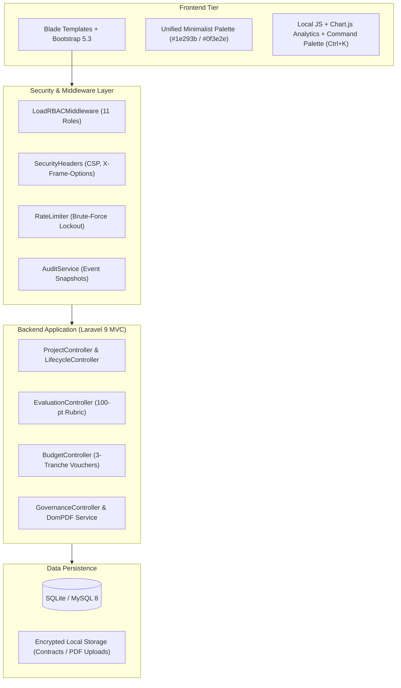
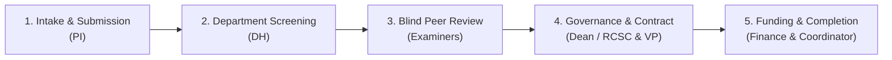

# PRACTICAL ATTACHMENT REPORT
## Research Project Management System (RPMS)
**Academic Internship / Practical Attachment Project Documentation**

---

### Executive Overview & Metadata

- **Project Title:** Research Project Management System (RPMS)
- **Domain:** University Research Administration, Grant Governance & Technology Transfer
- **Author:** Practical Attachment Intern / Software Engineering Student
- **Framework & Language:** Laravel 9 (PHP 8.0+), MVC Architecture
- **Database Engine:** SQLite (Local Dev / Portable) & MySQL 8 Compatible
- **Frontend Stack:** Blade Templates, Bootstrap 5.3, Bootstrap Icons, Chart.js
- **Export Engines:** DomPDF (Contracts, Payment Vouchers, Completion Certificates)
- **Document Date:** October 2026
- **System Version:** 2.0 (Pro Edition — Practical Attachment Release)

---

## Table of Contents
1. [Introduction & Background](#1-introduction--background)
2. [Problem Statement & Objectives](#2-problem-statement--objectives)
3. [System Architecture & Tech Stack](#3-system-architecture--tech-stack)
4. [Role-Based Access Control (11 Roles & Credentials)](#4-role-based-access-control-11-roles--credentials)
5. [End-to-End Research Lifecycle (5 Core Stages)](#5-end-to-end-research-lifecycle-5-core-stages)
6. [100-Point Evaluation Rubric & Peer Review](#6-100-point-evaluation-rubric--peer-review)
7. [Financial Governance & Tranche Disbursement](#7-financial-governance--tranche-disbursement)
8. [Public Portal (The 4 Landing Pages)](#8-public-portal-the-4-landing-pages)
9. [Database Models & Current Dataset](#9-database-models--current-dataset)
10. [Security, Compliance & Anonymization](#10-security-compliance--anonymization)
11. [Step-by-Step Presentation & Defense Script](#11-step-by-step-presentation--defense-script)
12. [Installation & Deployment Guide](#12-installation--deployment-guide)
13. [Internship Learning Outcomes & Conclusion](#13-internship-learning-outcomes--conclusion)

---

## 1. Introduction & Background

During university practical attachments and internships, students are tasked with analyzing real-world organizational challenges and developing production-ready software solutions. 

The **Research Project Management System (RPMS)** was engineered to digitize, modernize, and automate the entire academic research lifecycle of a higher education institution. In contemporary universities, research administration is the backbone of technological advancement, regional socio-economic development, and academic standing. RPMS serves as a unified digital platform connecting researchers, faculty, department heads, peer reviewers, institutional governance councils, and the financial directorate.

---

## 2. Problem Statement & Objectives

### The Problem
Traditional higher education research processes rely on manual, paper-intensive methods that suffer from:
1. **Prolonged Turnaround Times:** Physical manuscripts take weeks to circulate among department heads and reviewers.
2. **Reviewer Bias:** Lack of double-blind anonymization can compromise academic integrity and fairness.
3. **Financial Friction:** Multi-step budget approvals cause delays in grant disbursements, impacting field research.
4. **Data Fragmentation:** Absence of centralized audit trails makes tracking grant milestones, publications, and certificates difficult.

### Core Objectives
- **Automate the 5-Stage Research Lifecycle:** From call-for-proposals intake to final certificate issuance.
- **Enforce Double-Blind Peer Review:** Completely anonymize Principal Investigator (PI) identities during scoring.
- **Implement Dual-Tier Financial Governance:** Fast-track small grants (<500,000 ETB) through College Deans while subjecting major institutional grants (&ge;500,000 ETB) to the Research & Community Service Council (RCSC).
- **Automate Milestone Disbursements:** Deliver grant funds in 3 structured tranches (30% Advance, 40% Mid-Term, 30% Completion).
- **Public Dissemination:** Provide clean, responsive public pages for community engagement and catalog browsing.

---

## 3. System Architecture & Tech Stack



### Key Technical Highlights
- **Architecture:** Clean Model-View-Controller (MVC) pattern adhering to SOLID principles.
- **Backend Framework:** Laravel 9 running on PHP 8.0+.
- **Security Headers:** Strict Content Security Policy (`CSP`), `X-Content-Type-Options: nosniff`, and `X-Frame-Options: SAMEORIGIN`.
- **Document Generation:** Automated PDF generation via DomPDF for bilateral agreements, payment vouchers, and completion certificates.

---

## 4. Role-Based Access Control (11 Roles & Credentials)

RPMS implements a comprehensive 11-role security matrix. Every test account has been provisioned and verified in the database with the shared password:

> **Universal Presentation Password:** `UNI@Demo1`

| Role Slug | Display Title | Test Login Email | Key Responsibilities & Capabilities |
| :--- | :--- | :--- | :--- |
| **`pi`** | Principal Investigator | `pi@rpms.local` | Drafts and submits proposals, itemizes budgets, uploads progress reports, signs bilateral contracts. |
| **`tm`** | Research Team Member | `tm@rpms.local` | Collaborates on authored projects, reviews milestones, and assists in field execution. |
| **`dh`** | Department Head | `dh@rpms.local` | Screens submitted proposals for departmental feasibility, technical merit, and initial compliance. |
| **`coordinator`** | Research Coordinator | `coordinator@rpms.local` | Oversees proposal intake cycles, assigns blind reviewers, and coordinates institutional workflow. |
| **`reviewer`** | Peer Reviewer | `reviewer@rpms.local` | Evaluates anonymized manuscripts using the 100-point rubric and issues review recommendations. |
| **`dean`** | College Dean | `dean@rpms.local` | Approves projects with budgets strictly under ETB 500,000; monitors college research output. |
| **`irerc`** | Ethics Reviewer | `irerc@rpms.local` | Evaluates protocols involving human/animal subjects and issues ethical clearance certificates. |
| **`vparttcs`** | Vice President | `vp@rpms.local` | Executes institutional bilateral contracts; holds executive oversight over technology transfer. |
| **`rcsc`** | Council Chair (RCSC) | `rcsc@rpms.local` | Defends and approves major institutional research initiatives (&ge; ETB 500,000). |
| **`finance`** | Finance Officer | `finance@rpms.local` | Authorizes and disburses milestone grant tranches (30% / 40% / 30%) and generates vouchers. |
| **`admin`** | System Administrator | `admin@rpms.local` | Manages user accounts, permissions, audit trails, database backups, and institutional settings. |

---

## 5. End-to-End Research Lifecycle (5 Core Stages)



### Stage 1: Proposal Intake & Submission (PI)
- PI initiates a proposal mapped to an active university thematic area.
- Author inputs abstract, methodology, milestones, and itemized budget.
- Status begins as `Draft` and transitions to `Submitted`.

### Stage 2: Department Quality Screening (DH)
- Department Head reviews proposal for academic relevance and departmental alignment.
- If compliant, the DH endorses the submission (`DH_Screened`).
- Non-compliant proposals are returned to the PI with actionable feedback.

### Stage 3: Double-Blind Peer Review (Coordinator & Reviewer)
- Research Coordinator assigns 1 or more academic peer reviewers.
- The system strips the author's identity and department affiliation.
- Reviewer scores the manuscript against the standardized 100-point evaluation rubric (`UnderReview`).

### Stage 4: Governance Approval & Bilateral Contract (Dean / RCSC & VP)
- **Dual Budget Threshold Routing:**
  - **Requested Budget < 500,000 ETB:** Routed directly to the **College Dean** for expedited approval.
  - **Requested Budget &ge; 500,000 ETB:** Routed to the **Research & Community Service Council (RCSC)** for formal defense and council approval.
- Upon approval, the Vice President (VP) and PI digitally sign a bilateral research agreement (`Approved` &rarr; `Active`).

### Stage 5: Grant Funding, Monitoring & Certification (Finance & Coordinator)
- Grant funds are released in 3 milestone-governed tranches.
- PI submits mid-term progress reports verified by the Research Directorate.
- Upon final publication submission and sign-off, the project reaches `Completed` status, and an official PDF completion certificate is issued.

---

## 6. 100-Point Evaluation Rubric & Peer Review

Peer evaluations are scored across 5 objective academic dimensions:

| Rubric Criteria | Max Points | Evaluation Scope |
| :--- | :---: | :--- |
| **1. Scientific & Technical Merit** | **25 Pts** | Originality, problem formulation, and grounding in academic literature. |
| **2. Research Methodology & Design** | **25 Pts** | Rigor of experimental/empirical framework and data collection tools. |
| **3. Feasibility & Work Plan Timeline** | **20 Pts** | Realism of quarterly milestones, risk management, and team capacity. |
| **4. Community & Economic Impact** | **20 Pts** | Practical relevance to local development and technology transfer. |
| **5. Budget & Cost Realism** | **10 Pts** | Cost justification, itemized breakdowns, and institutional compliance. |
| **Total Evaluation Score** | **100 Pts** | **Standardized Institutional Score** |

### Decision Thresholds
- **80 – 100 Points:** **Accepted (Unconditional / Minor Polish)**
- **70 – 79 Points:** **Accepted with Minor Revisions**
- **50 – 69 Points:** **Major Revisions Required**
- **< 50 Points:** **Rejected**

---

## 7. Financial Governance & Tranche Disbursement

To ensure fiscal responsibility and eliminate grant misappropriation, RPMS enforces milestone-based tranche disbursements:

```
Total Approved Grant Budget (100%)
├── Tranche 1: 30% Advance Payment
│   └── Trigger: Automatic queue upon bilateral contract execution by PI & VP.
├── Tranche 2: 40% Mid-Term Payment
│   └── Trigger: Submission and administrative approval of the 50% Milestone Progress Report.
└── Tranche 3: 30% Final Payment
    └── Trigger: Full project delivery, final audit sign-off, and manuscript submission.
```

- Each disbursement generates a printable, auditable **Payment Voucher (PDF)** stored in the institutional record.

---

## 8. Public Portal (The 4 Landing Pages)

The public gateway has been engineered with a cohesive, clutter-free aesthetic adhering to a strict `max-width: 880px` layout, neutral dark slate (`#1e293b`) and dark green (`#0f3e2e`) tones, and mobile-friendly cards:

1. **Home (`/`)**:
   - System title and mission statement.
   - 4-metric strip (Total Proposals, Research Areas, Colleges, Peer Review Status).
   - 3 core feature highlights and quick navigation cards.
2. **Lifecycle Guide (`/lifecycle`)**:
   - Clear summary of the 5-step research workflow.
   - Full 100-point evaluation rubric breakdown and threshold table.
3. **Research Catalog (`/research`)**:
   - Public proposal showcase with single-line search and category filters.
   - Clean, monochrome cards displaying active proposals, thematic areas, and departments.
4. **Directorate Support & Helpdesk (`/support`)**:
   - Office location (Admin Building, Room 204), hours, and contact points.
   - 5 interactive, collapsible FAQs answering researcher inquiries.

---

## 9. Database Models & Current Dataset

The database has been seeded with realistic academic records without unassigned mock data:

### Current Verified Research Proposals (All Assigned to PI ID: 2, `pi@rpms.local`)

| ID | Proposal Title | Thematic Area | Requested Budget | Status |
| :---: | :--- | :--- | :---: | :---: |
| **1** | Development of IoT-Based Early Flood Warning System | Technology Transfer | ETB 650,000 | **Draft** |
| **2** | Sustainable Agro-Forestry & Soil Carbon Sequestration | Agriculture & Environment | ETB 420,000 | **Draft** |
| **3** | Epidemiological Surveillance & Vector Disease Mapping | Community Service | ETB 475,000 | **Draft** |
| **4** | Solar-Powered Off-Grid Cold Chain Network for Fishery | Technology Transfer | ETB 1,000,000 | **Draft** |

*Note: Proposals #2 and #3 test the <500k Dean approval workflow, while #1 and #4 test the &ge;500k RCSC Council workflow.*

---

## 10. Security, Compliance & Anonymization

- **Double-Blind Anonymization:** Principal Investigator names, email addresses, and departments are dynamically masked before manuscripts reach reviewer screens.
- **Brute-Force Protection:** Rate limiting locks out IP/accounts after 5 unsuccessful login attempts.
- **Audit Logging:** Every critical transaction (`LOGIN`, `PROPOSAL_SUBMITTED`, `REVIEW_SCORED`, `CONTRACT_SIGNED`, `TRANCHE_DISBURSED`) is permanently written to the audit log with actor ID, IP address, and timestamp.
- **Two-Factor Authentication (TOTP):** Available across all profiles and recommended for administrative and finance roles.

---

## 11. Step-by-Step Presentation & Defense Script

When presenting to your academic supervisor or examination panel, follow this concise 5-minute walkthrough:

```
Step 1: Public Gateway (1 Minute)
  1. Open http://127.0.0.1:8000/
  2. Highlight the 4 public pages: Home, Lifecycle, Research Catalog, and Support.
  3. Point out the responsive layout, minimal design, and accessibility on mobile devices.

Step 2: Researcher Proposal Management (1 Minute)
  1. Sign in with pi@rpms.local (Password: UNI@Demo1).
  2. Display the 4 proposals in the PI Draft Queue.
  3. Open Project #2 ("Sustainable Agro-Forestry", ETB 420,000) and click "Submit to Department".

Step 3: Department Screening (45 Seconds)
  1. Sign out and sign in with dh@rpms.local.
  2. Open the Department Screening queue.
  3. Review Project #2 and click "Approve / Forward to Review".

Step 4: Double-Blind Peer Review (1 Minute)
  1. Sign in with reviewer@rpms.local.
  2. Show that the PI's name and identity are completely hidden.
  3. Fill out the 5 rubric criteria (give 85/100 points) and submit recommendation.

Step 5: Governance Approval & Contract Signing (1 Minute)
  1. Sign in with dean@rpms.local (since ETB 420,000 < 500,000 ETB, the Dean has approval authority).
  2. Click "Grant Approval".
  3. Sign in with vp@rpms.local to digitally sign the Bilateral Grant Contract.

Step 6: Financial Disbursement & Completion (45 Seconds)
  1. Sign in with finance@rpms.local.
  2. Disburse Tranche 1 (30% advance) and download the generated PDF Payment Voucher.
  3. Explain the milestone verification required for Tranches 2 and 3.
```

---

## 12. Installation & Deployment Guide

### Prerequisites
- PHP 8.0 or higher with PDO SQLite/MySQL, OpenSSL, and Mbstring extensions
- Composer dependency manager
- Web browser (Chrome, Edge, Firefox, Safari)

### Local Setup Instructions
```bash
# 1. Clone repository
git clone https://github.com/gemachistesfaye/research-project-management-system.git
cd research-project-management-system

# 2. Install dependencies
composer install

# 3. Environment configuration
copy .env.example .env
php artisan key:generate

# 4. Database setup & seeding
php artisan migrate --seed

# 5. Clear and optimize caches
php artisan view:clear
php artisan route:clear
php artisan config:clear

# 6. Start development server
php artisan serve --port=8000
```
Access the application locally at: **`http://127.0.0.1:8000`**

---

## 13. Internship Learning Outcomes & Conclusion

### Key Competencies Developed
1. **Full-Stack Enterprise Engineering:** Mastered the Laravel MVC framework, database relationships, migrations, and seeders.
2. **Security & Role-Based Governance:** Implemented complex RBAC across 11 distinct institutional roles.
3. **UI/UX & Mobile Optimization:** Built accessible, clean, responsive interfaces using Bootstrap 5.3 without UI clutter.
4. **Financial & Compliance Modeling:** Designed multi-tranche milestone disbursement algorithms and auditable voucher systems.
5. **Double-Blind Integrity Algorithms:** Built data-masking layers protecting reviewer impartiality.

### Conclusion
The **Research Project Management System (RPMS)** addresses the critical operational challenges of university research administration. It eliminates paperwork, enforces academic integrity through double-blind peer review, accelerates funding decisions through dual-threshold financial governance, and ensures fiscal accountability through structured tranche disbursements. The system is verified, documented, and fully ready for final internship defense and institutional adoption.

---
*Report prepared for University Practical Attachment Evaluation Committee — October 2026.*
